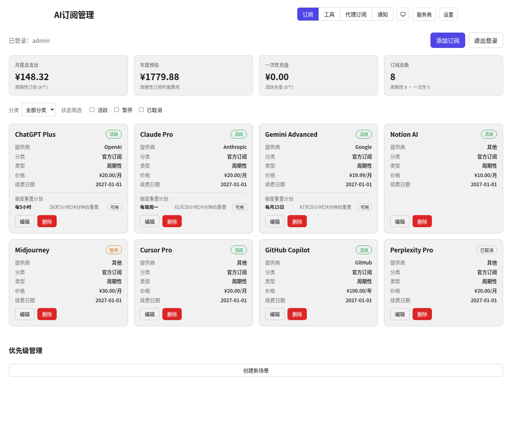
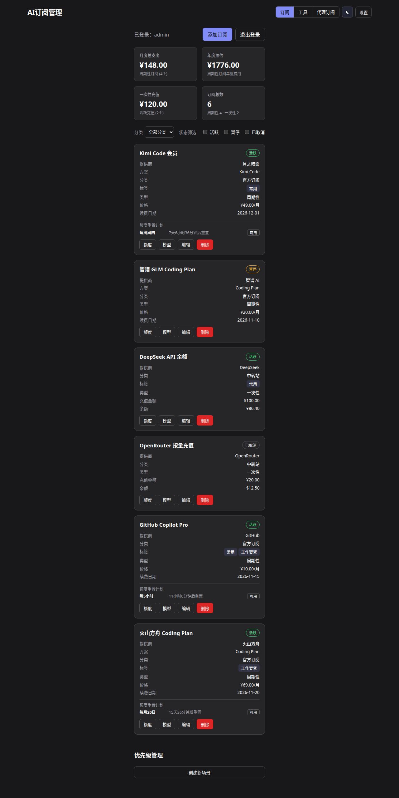
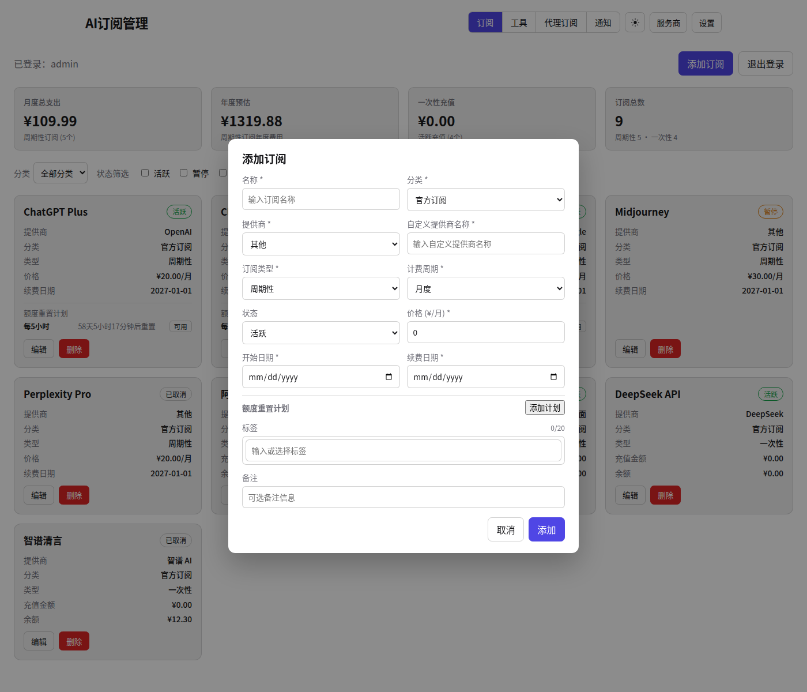
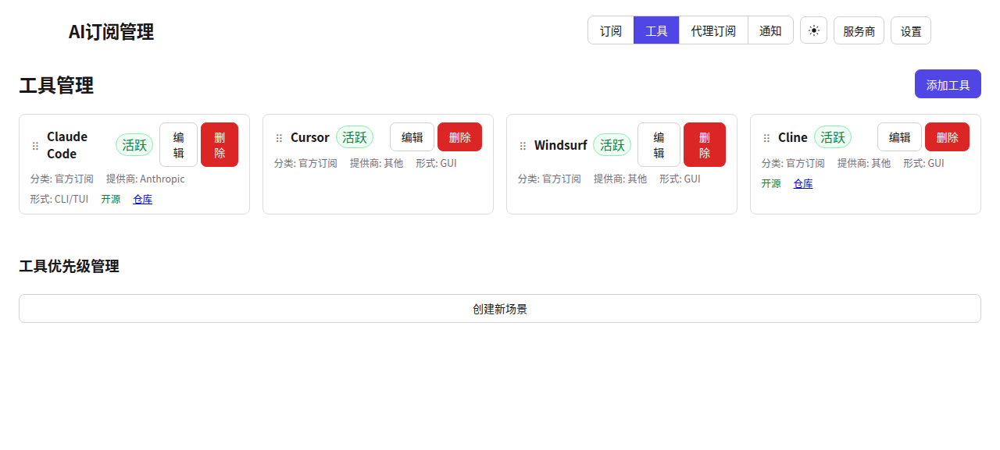
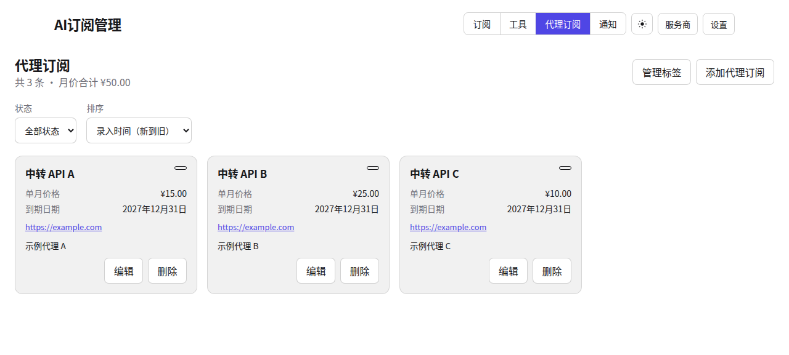

# AI订阅管理工具

一个用于管理AI订阅服务的Web应用，帮助您追踪支出、分析使用情况，并及时了解续费信息。

## 界面预览

订阅管理支持浅色 / 深色主题，重置倒计时按紧迫度着色：

| 浅色                                                          | 深色                                                         |
| ------------------------------------------------------------- | ------------------------------------------------------------ |
|  |  |

订阅表单（凭据加密保存、按提供商适配输入项）、工具清单（多形态标签、拖拽排序）、代理订阅（独立标签管理）：

| 添加订阅                                            | 工具清单                                | 代理订阅                                              |
| --------------------------------------------------- | --------------------------------------- | ----------------------------------------------------- |
|  |  |  |

登录页（默认账号 `admin/admin123`，首次登录强制改密）：


> 截图为演示数据，非真实订阅信息。

## 功能特性

- **订阅管理**: 添加、编辑、删除AI订阅服务（周期性/一次性），支持凭据保存与连通性测试
- **支出统计**: 实时显示月度和年度总支出（图表功能按 ADR-0018 范围修订不移植）
- **分类与标签**: 按分类和状态筛选订阅，标签可复用
- **状态跟踪**: 支持活跃、暂停、已取消三种状态
- **续费提醒**: 自动标记即将续费的订阅（7天内）
- **工具与代理订阅**: 独立的工具清单、代理订阅记录与标签
- **用量查询**: 火山、阿里、DeepSeek 等提供商的实时用量/余额/模型查询
- **重置计划**: fiveHour/weekly/monthly 重置跟踪、对齐与校准
- **通知**: 飞书应用机器人通知与 WS 监听
- **数据持久化**: SQLite 本地存储，自动快照备份

## 技术栈

- **后端**: Go 1.27 + chi，编译为单二进制
- **前端**: Vite + SolidJS，SPA 经 `go:embed` 嵌入二进制
- **存储**: SQLite（`modernc.org/sqlite`，WAL）
- **认证**: 无状态 HMAC 签名 cookie
- **部署**: Docker（默认，distroless 运行）或 systemd 用户服务

架构决策见 `docs/adr/0017-storage-engine-sqlite-migration.md` 与
`docs/adr/0018-go-solidjs-single-binary-rewrite.md`。

## 快速开始

### 从源码构建

前置要求：Go 1.27+、Node.js 24+、npm。

```bash
make build     # 构建 web/ SPA 并编译 Go 单二进制
make run       # 运行，默认监听 :3000
```

访问 `http://localhost:3000`。默认账号 `admin/admin123`，首次登录会要求修改密码。

### 开发模式

```bash
cd server && go run ./cmd/server     # 后端 :3000
npm --prefix web run dev             # Vite 开发服务器，/api 代理到 :3000
```

### Docker（默认）

```bash
make deploy    # 构建镜像并启动容器
make status
make logs
```

详见 `deploy/docker/README.md`。

## 配置

| 变量              | 说明                                                                                                                                   |
| ----------------- | -------------------------------------------------------------------------------------------------------------------------------------- |
| `DATA_DIR`        | 数据目录（SQLite 库与 `backups/`）。容器内固定 `/data`；未设时回退 `XDG_DATA_HOME/ai-subscriptions`、`~/.local/share/ai-subscriptions` |
| `NEXTAUTH_SECRET` | 凭据加密密钥与会话签名密钥；未设时使用随机值，重启后会话失效                                                                           |
| `PORT`            | 监听端口，默认 3000                                                                                                                    |

## 数据与迁移

- 数据存于 `DATA_DIR/ai-subscriptions.db`（SQLite，WAL）；快照在 `DATA_DIR/backups/`，保留 10 份。
- 首次启动若发现旧版 JSON 数据（`subscriptions.json` 等），会先做 JSON 快照，再单向导入 SQLite；
  加密凭据密文原样搬运、不解密重加密（ADR-0017）。
- 迁移演练（只读源目录，校验行数与密文逐字节一致）：

```bash
cd server && go run ./cmd/migration-drill --source <旧 data 目录>
```

## 项目结构

```
ai-subscriptions/
├── server/                 # Go 后端 + go:embed 的 SPA
│   ├── cmd/server/         # 进程入口
│   ├── cmd/migration-drill/# JSON→SQLite 迁移演练
│   └── internal/           # auth、store、providers、scheduler、notify、httpapi...
├── web/                    # Vite + SolidJS 前端
│   └── src/                # pages、components、各领域模块
├── deploy/
│   ├── docker/             # Docker 部署（默认）
│   └── systemd/            # systemd 用户服务（备选）
├── docs/                   # ADR、parity 矩阵、计划与演练记录
├── Dockerfile              # 多阶段镜像（node → go → distroless）
└── Makefile                # 构建/测试/部署命令族
```

## 构建与部署

```bash
make build     # 单二进制（含嵌入 SPA）
make test      # Go + vitest 全量
make deploy    # Docker 部署（默认）
make -C deploy/systemd install   # systemd 用户服务（备选）
```

Docker 与 systemd 同占 3000 端口，任选其一，不可同时启用。详见 `deploy/docker/README.md` 与
`deploy/systemd/README.md`。

## 开发命令

| 命令                         | 说明                           |
| ---------------------------- | ------------------------------ |
| `make build`                 | 构建单二进制                   |
| `make test`                  | Go + 前端全量测试              |
| `make web-build`             | 只构建 SPA 并暂存给 `go:embed` |
| `make server-build`          | 只编译 Go 二进制               |
| `cd server && go test ./...` | Go 测试                        |
| `npm --prefix web test`      | 前端 vitest                    |
| `npm --prefix web run dev`   | 前端开发服务器                 |

## 许可证

MIT License
